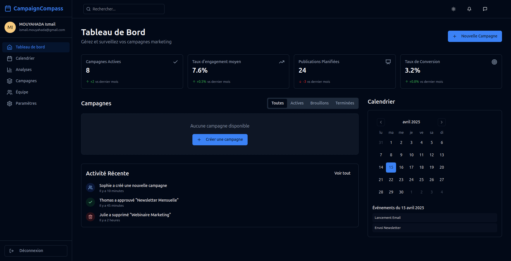

# Compagin Compass

# 📊 CampaignCompass

CampaignCompass est une plateforme de gestion et de suivi de campagnes marketing, conçue pour aider les équipes à organiser, visualiser et analyser leurs campagnes de manière efficace.

## 🚀 Fonctionnalités

- 📋 **Tableau de bord intuitif** : Vue d’ensemble claire sur les campagnes actives, les taux d’engagement, les publications planifiées et les conversions.
- 🗓️ **Calendrier intégré** : Suivi des événements et actions planifiées par date.
- 📈 **Analyses détaillées** : Visualisation des performances et KPIs pour optimiser les campagnes.
- 👥 **Gestion d’équipe** : Collaboration facilitée avec suivi des actions en temps réel.
- ⚙️ **Paramétrage personnalisable** : Adaptez la plateforme à vos besoins marketing spécifiques.

## 🖼️ Aperçu de l’interface


## 🧑‍💻 Développeur

Ce projet a été développé par :

**Ismail MOUAYAHDA**  
📧 ismail.mouayahda@gmail.com  

## 🛠️ Stack Technique

- **Frontend** : React + Tailwind CSS + Lucide React
- **Backend** : (à spécifier si applicable)
- **Langue** : Français
- **Design** : Responsive, dark mode par défaut

## 📦 Installation (à adapter selon le stack utilisé)

```bash
# Clone du repo
git clone https://github.com/ton-compte/campaign-compass.git
cd campaign-compass

# Installation des dépendances
npm install

# Démarrage du projet
npm run dev

## Deploy

[](https://vercel.com/new/clone?repository-url=https%3A%2F%2Fgithub.com%2Fghostland-dev%2Fcampaign-compass-platform)

Click the button to deploy your own copy on Vercel in one step.
